# PetLive: escopo do negócio e fluxos do produto

Este documento é a fonte única do escopo do PetLive. A **Parte A** (seções 1 a 16) descreve a visão, o que será construído e as regras. A **Parte B** (seções 17 a 27) organiza o produto para desenvolvimento: papéis, navegação, fluxos, estados, dados, notificações, backend e ordem de construção.

| Recurso | Link |
| --- | --- |
| Protótipo (98 telas e páginas) | https://claude.ai/artifact/UFhxFUGwCYokbjPKCXDqKK |
| Imagens das telas | [prototipo/imagens](prototipo/imagens/README.md) |
| Plano de criação | https://claude.ai/code/artifact/871f3a23-4e21-4456-861f-b630c089235f |
| Board de tarefas (194 tasks) | https://github.com/users/CodaxiKing/projects/5 |

Itens entre colchetes, como `[valor]` ou `[x]%`, ainda não foram decididos. Os nomes de rota, tabela e função da Parte B são **propostas de partida**: podem mudar na implementação, mas o comportamento descrito deve ser mantido.

---

# Parte A: escopo

## 1. Visão

**PetLive** é um aplicativo que organiza a saúde do pet e conecta o tutor a clínicas, petshops e prestadores de serviço da sua região.

Em uma frase: a carteira de saúde do pet, com lembretes e mapa, que vira um marketplace de produtos e serviços pet.

### Problema

- Tutores perdem datas de vacina, vermífugo e remédio e não têm o histórico à mão na consulta.
- Não é simples saber onde há clínica 24h, banho e tosa ou petshop por perto.
- Lojas e clínicas pequenas não têm uma forma simples de receber pedidos e agendamentos.

### Proposta de valor

- **Tutor:** saúde do pet em um só lugar, lembretes que avisam, serviços e produtos a poucos toques.
- **Lojista:** vitrine, agenda, entrega e recebimento sem montar sistema próprio.
- **Diferencial:** o app sabe o que o pet precisa. Vacina vencendo leva à clínica, ração acabando leva ao petshop.

### Escopo geográfico e idioma

- Lançamento no **Rio de Janeiro**.
- Português do Brasil.
- Cães e gatos no MVP. Outras espécies ficam para depois.

---

## 2. Públicos

| Público | Quem é | O que precisa |
| --- | --- | --- |
| Tutor | Dono de cão ou gato | Carteira de saúde, lembretes, mapa, reservas, pedidos e entrega |
| Lojista | Petshop, clínica veterinária, banho e tosa, creche, hotel, passeador | Vitrine, agenda, solicitações, entregas, estoque, recebimentos |
| Equipe da loja | Gerente, atendente, tosador, passeador | Parte das telas do lojista, conforme a função |
| Quem acha um pet | Qualquer pessoa que escaneia o QR da coleira | Contato rápido com o tutor, sem instalar o app |
| Equipe PetLive | Admin, financeiro, suporte, moderação, marketing | Monitorar assinaturas, avaliações, lojas, pedidos, privacidade e sistema |

---

## 3. Produtos

| Produto | Plataforma | Quem usa |
| --- | --- | --- |
| App do tutor | React Native com Expo (celular) | Tutor |
| App do lojista | Celular (PWA ou nativo, a decidir) | Lojista, equipe e passeador |
| Painel do lojista | Web, no computador | Lojista e equipe |
| Painel admin | Web, no computador | Equipe PetLive |
| Site do PetLive | Web | Tutores e lojistas novos |
| Página pública do QR | Web | Quem encontra um pet |
| Backend | Supabase | Todos |

---

## 4. Funcionalidades por módulo

### 4.1 App do tutor

**Conta e perfil**
- Boas-vindas, criar conta e entrar (e-mail e Google), aceite de termos e LGPD.
- Perfil do tutor, excluir conta e exportar dados.

**Pets**
- Cadastro com foto, espécie, raça e nascimento. Lista Meus pets e tela do pet.
- Vários pets (limite no plano grátis).

**Saúde**
- Registrar vacinas com data aplicada e próxima dose, com calendário sugerido por espécie e idade.
- Peso com gráfico, consultas e anexos (foto do cartão e exames, no Premium).

**Lembretes e remédios**
- Lembretes de vacina, vermífugo, consulta, banho e tosa e outros personalizados.
- Remédios com dose, frequência, horários e duração, com confirmação a cada dose.
- Notificações push e tela de Avisos (por tipo, horário e Não perturbe).

**Mapa**
- Clínicas, petshops, banho e tosa e veterinários 24h por perto, com filtros, ficha do lugar, ligar, WhatsApp e rota.
- Atalho: vacina vencendo leva às clínicas próximas.

**Compartilhar e segurança (Premium)**
- Carteira em PDF para o veterinário, QR Code da coleira, acesso compartilhado com a família.

**Loja e serviços (marketplace)**
- Vitrine de produtos, detalhe do produto, solicitação e acompanhamento do pedido.
- Produtos com receita: aparecem só para consulta, sem solicitação nem pagamento no app.
- Serviços: banho e tosa, passeio, creche e hotelzinho, cada um com a sua reserva (seção 6).
- **Entrega ou retirada** com endereço, taxa e prazo da loja, e acompanhamento da entrega com código.
- **Cupom de desconto** no pagamento.
- Pagamento por Pix no app ou pagar na loja.
- **Chat com a loja** a partir de um pedido ou reserva.
- **Avaliar** a loja e o serviço depois do atendimento.
- Passeio ao vivo: trajeto, fotos e resumo com avaliação.

### 4.2 App do lojista (celular)

- Cadastro da loja em 5 passos: dados, endereço e contato, o que oferece, serviços, publicar.
- Painel com indicadores, solicitações e agenda de hoje.
- Solicitações: aceitar, recusar, responder, marcar pronto e concluir.
- Catálogo e cadastro de produto (foto, código de barras, preço, estoque, tipo de venda).
- Configuração de cada serviço, horários de atendimento, folgas e confirmação automática ou manual.
- Agenda do dia e da semana.
- **Entrega e retirada:** liga e desliga cada opção, taxa, raio, pedido mínimo, frete grátis e prazo.
- Visão do passeador: iniciar e encerrar passeio, GPS, fotos e registros.
- Configurações da loja.

### 4.3 Painel do lojista (computador)

- Solicitações com lista e detalhe, aceite e resposta.
- Catálogo em tabela, cadastro e edição de produto, importação por planilha.
- Serviços, agenda semanal, recebimentos e configurações.
- **Entrega e retirada (configuração):** modo de taxa fixa, por bairro ou por distância, tabela de bairros, raio, mínimo, frete grátis, prazo, quem entrega e horário.
- **Entregas:** fila do dia com entregador e status até a casa do tutor.
- **Mensagens** com os tutores, ligadas ao pedido.
- **Estoque** com mínimo, alerta e pausa automática do produto.
- **Promoções e cupons** da loja.
- **Avaliações da loja** com resposta pública.
- **Relatórios** de vendas, agenda e clientes.
- **Equipe da loja** com funções e permissões.

### 4.4 Painel admin (computador)

Uso interno da equipe PetLive, com login e verificação em duas etapas.

| Área | O que faz |
| --- | --- |
| Visão geral | Assinantes Premium, receita, tutores, lojas e alertas do dia |
| Relatórios | Funil até o Premium, retenção e bairros |
| Assinaturas | Quem paga, em teste, com falha ou cancelou, e motivos de cancelamento |
| Planos e cupons | Preço do Premium, teste grátis, cupons e comissão das lojas |
| Pedidos e disputas | Todos os pedidos, estornos e conflitos entre tutor e loja |
| Financeiro | Receita por origem, comissões e repasses às lojas |
| Avaliações dos apps | Notas e comentários do Google Play e da App Store, com resposta |
| Usuários e pets | Busca de tutor, ficha e ações de suporte |
| Lojistas | Aprovação de cadastro e análise de documentos |
| Suporte | Fila de chamados, prioridade e respostas prontas |
| Moderação | Denúncias, anúncios e pets encontrados |
| Campanhas | Push e e-mail por público, com agendamento |
| Conteúdo mestre | Calendário de vacinas, raças e categorias |
| Integrações | Estado do Play Console, App Store Connect, Pix, Supabase, Sentry e push |
| Sistema | Versões do app, erros e recursos ligados |
| Privacidade e LGPD | Pedidos de exportar ou apagar dados e regras de retenção |
| Equipe | Pessoas, funções, permissões e registro de ações |

### 4.5 Site e página pública

- Site para tutores e página para lojistas.
- Página pública do QR: nome do pet, contato do tutor e envio de localização, só com o que o tutor permitiu.

---

## 5. Regras de negócio

### 5.1 O que a loja oferece

A loja escolhe **produtos**, **serviços** ou **os dois**. Isso define o que aparece na vitrine e na agenda.

### 5.2 Produtos

- Tipos de venda por produto:
  - **Pelo app:** o tutor solicita e paga por Pix ou na loja.
  - **Só no local, com receita:** aparece com preço e estoque, mas não pode ser solicitado nem pago pelo app. A loja define a mensagem ao tutor e se pede a receita na retirada.
  - **Oculto:** só para controle da loja.
- Medicamentos veterinários seguem regras próprias de venda. No início, a vitrine começa por ração, acessórios e serviços.

### 5.3 Solicitações

- Fluxo de status na seção 20.1.
- A loja tem um prazo de resposta configurável. Sem resposta, o tutor é avisado.
- Retirada na loja ou entrega feita pela própria loja (regras na seção 5.8).

### 5.4 Pagamentos

| Etapa | Pagamento |
| --- | --- |
| Etapa 1 | Na loja, fora do app |
| Etapa 2 | Pix pelo app com confirmação automática, repasse à loja e comissão `[x]%` |
| Etapa 3 | Entrega integrada e assinatura recorrente de ração |

A comissão incide só sobre pagamentos feitos pelo app. Vitrine e agenda são gratuitas.

### 5.5 Cancelamento e confirmação

- Cancelamento grátis até um prazo definido pela loja (exemplo: 2 horas antes).
- A loja escolhe entre confirmação automática e manual dos agendamentos.

### 5.6 QR da coleira

- O tutor escolhe o que aparece ao escanear: nome e foto, telefone e alergias.
- Quem acha o pet pode enviar a localização, só se tocar no botão.
- O telefone do tutor só aparece se o tutor tiver liberado esse campo.

### 5.7 Aviso de saúde

O PetLive organiza informações e não substitui o atendimento veterinário. Esse aviso aparece no app e no site.

### 5.8 Entrega e retirada

- A loja liga ou desliga **retirada** e **entrega** de forma independente. Uma das duas precisa estar ligada para a loja vender produtos.
- **Retirada:** prazo para separar o pedido, horário de retirada e aviso ao tutor.
- **Entrega pela loja:** a loja escolhe o modo da taxa.

| Modo | Como a taxa é calculada |
| --- | --- |
| Fixa | Um valor único dentro do raio |
| Por bairro | Valor e prazo por bairro, com liga e desliga por bairro |
| Por distância | Valor por faixa de km a partir da loja, até o raio máximo |

- Outras regras da entrega: **raio máximo**, **pedido mínimo**, **frete grátis acima de** `[valor]`, **prazo estimado**, **quem entrega** (equipe da loja) e **horário das entregas**.
- Endereço fora do raio, ou em bairro desligado, só permite retirada. O app mostra o motivo.
- O tutor vê a taxa e o prazo **antes** de pagar. O valor da taxa fica gravado no pedido e não muda depois.
- A entrega gera um **código de 4 dígitos** que o tutor passa ao entregador. Só com o código a entrega vira "entregue".
- Taxa de entrega não entra na base da comissão do app `[a definir]`.
- Entrega integrada com logística própria fica na etapa 3.

### 5.9 Cupons

- Cupom da **loja** (criado no painel do lojista) vale só naquela loja. Cupom do **PetLive** (criado no admin) vale em qualquer loja ou no Premium.
- Tipos: percentual, valor fixo e dias de Premium grátis.
- Campos: código, valor, vale para (produtos, serviços ou ambos), limite de usos, validade e valor mínimo.
- Um cupom por pedido. Cupom não reduz a taxa de entrega, a menos que o tipo seja "frete grátis" `[a definir]`.
- Quem paga o desconto: cupom da loja sai da loja e cupom do PetLive sai do PetLive. O repasse considera isso.

### 5.10 Estoque

- Estoque por produto, com **mínimo** de aviso.
- A baixa acontece quando o pedido é **confirmado** pela loja. Cancelamento devolve ao estoque.
- Quando chega a zero e a opção "esconder do app" está ligada, o produto sai da vitrine sozinho.
- Produto sem estoque nunca pode ser confirmado.

### 5.11 Avaliações

- Só quem teve um pedido ou reserva **concluído** pode avaliar, uma vez por pedido.
- Nota de 1 a 5, tags (atendimento, pontualidade, preço, cuidado com o pet, limpeza), texto e foto opcionais.
- A loja pode responder publicamente, uma vez. Denúncias vão para a moderação do admin.
- A nota da loja é a média das avaliações dos últimos 12 meses.

### 5.12 Chat

- Uma conversa por pedido ou reserva, entre o tutor e a loja. Qualquer pessoa da equipe com permissão responde.
- Mensagens de texto e respostas rápidas. O chat fecha 7 dias após a conclusão do pedido.
- Trocar contato por fora do app é desencorajado no texto da tela, mas não é bloqueado.

### 5.13 Premium e assinaturas

- Teste grátis de `[7]` dias para quem nunca assinou. Cobrança avisada `[2]` dias antes.
- Planos mensal e anual, pagos por Pix ou cartão.
- Falha de cobrança: novas tentativas por `[3]` dias. Sem sucesso, o plano volta a Grátis no fim do período já pago.
- Cancelar mantém o Premium até o fim do período pago.
- Pets além do limite do plano grátis ficam **somente leitura**, sem serem apagados.

### 5.14 Disputas e estornos

- O tutor pode abrir disputa até `[x]` dias depois do pedido pago pelo app.
- A loja responde em até `[48]` horas. Depois disso, a equipe PetLive decide.
- Decisões possíveis: estornar ao tutor, dar razão à loja ou pedir mais informações. O estorno é feito pelo Pix e desconta do próximo repasse da loja.

---

## 6. Modelos de reserva por serviço

Cada serviço usa uma forma de reserva, configurada pela loja.

| Serviço | Modelo | A loja configura | O tutor escolhe |
| --- | --- | --- | --- |
| Banho e tosa, consulta, vacinação | Por horário | Duração, vagas por horário, profissionais, intervalo | Dia e horário livre |
| Passeador | Passeio | Preço de 30 e 60 min, raio, pets por passeio, dias e janela, trajeto e fotos | Duração, dia, horário e endereço |
| Creche pet | Por dia | Dia inteiro e meio período, entrada e retirada, vagas por dia, pacotes mensais | Dias, período e pacote |
| Hotelzinho pet | Diárias | Preço por porte, vagas por dia, check-in e check-out, extras, vacinas em dia | Entrada, saída e extras |

**Horários livres** são calculados no servidor: horários da loja, menos folgas, menos reservas já feitas até o limite de vagas, respeitando a duração e o intervalo do serviço.

---

## 7. Dados (modelo inicial)

Resumo. O modelo completo, com campos, está na seção 21.

**Tutor e pets:** `profiles`, `pets`, `vaccinations`, `dewormings`, `weights`, `visits`, `medications`, `reminders`, `push_tokens`.

**Mapa:** `places` (importado do OpenStreetMap para o Rio de Janeiro).

**Marketplace:** `stores`, `store_members`, `products`, `services`, `store_hours`, `time_off`, `requests`, `request_items`, `request_events`, `payments`, `deliveries`, `delivery_zones`, `coupons`, `reviews`, `conversations`, `messages`, `lodging_rates`, `daycare_plans`, `walk_rules`.

**Plataforma:** `subscriptions`, `plans`, `disputes`, `support_tickets`, `campaigns`, `lgpd_requests`, `admin_members`, `audit_log`, `app_reviews`, `content_*`.

Campos de destaque:
- `stores.oferece`: produtos, serviços ou ambos.
- `services.modelo`: por horário, passeio, por dia ou diárias.
- `products.venda`: `app`, `local_com_receita` ou `oculto`. Produtos `local_com_receita` não aceitam `requests` nem `payments`.
- `requests`: `starts_at`, `ends_at` e, nas diárias, `checkin` e `checkout`.

Acesso protegido por regras de linha (RLS) no Supabase: cada tutor só vê os dados dos seus pets.

---

## 8. Stack

| Camada | Tecnologia |
| --- | --- |
| App do tutor | React Native, Expo, TypeScript, Expo Router |
| Mapa | MapLibre com tiles gratuitos (OpenFreeMap ou Protomaps) |
| Dados de lugares | OpenStreetMap via Overpass, com cadastro colaborativo; Google Places só como complemento pago |
| Endereço e distância | Geocodificação com OpenStreetMap (Nominatim ou similar) |
| Backend | Supabase: Auth, Postgres, Storage, Realtime, Edge Functions e cron |
| Notificações | expo-notifications (FCM e APNs) |
| Build e deploy | EAS Build e EAS Update |
| Erros | Sentry |
| Pagamentos (etapa 2) | Provedor de Pix `[a definir]`, com repasse |
| Painéis e site | Web em React `[framework a definir]` |

---

## 9. Roadmap

| Fase | Entrega | Prioridade no board |
| --- | --- | --- |
| 0 | Descoberta: wireframes, stack, cidade | Concluída |
| 1 | **MVP**: conta, pets, saúde, lembretes, remédios, mapa, Início | P0 e P1 |
| 2 | Beta e Premium: carteira em PDF, QR da coleira, anexos, família, painel admin básico | P2 |
| 3 | Rede social: perfil público, posts, feed (depois de validar a retenção) | Fora do board por enquanto |
| 4 | Social e mapa: check-ins, avaliações, selo de vacina, pets perdidos | Fora do board por enquanto |
| 5 | **Marketplace**: etapa 1 (vitrine, solicitação, agenda, entrega e retirada, chat, estoque, cupons, avaliações), etapa 2 (Pix, passeio ao vivo, repasse, disputas), etapa 3 (entrega integrada, assinatura de ração) | P2 e P3 |

**Gate:** a rede social só começa depois que o beta provar retenção.

### Prioridades (campo Priority do board)

| Prioridade | Significado |
| --- | --- |
| P0 | Máxima: caminho crítico do MVP |
| P1 | Resto do MVP |
| P2 | Premium, marketplace etapa 1, app e painéis |
| P3 | Marketplace etapas 2 e 3 e itens de apoio |

---

## 10. Monetização

- **Grátis:** 1 pet, lembretes básicos, mapa, solicitações e reservas.
- **Premium (tutor):** vários pets, PDF para o veterinário, anexos, acesso para a família, QR da coleira. Preço `[valor]` mensal e `[valor]` anual.
- **Lojista:** vitrine e agenda gratuitas. Comissão `[x]%` sobre pagamentos pelo app.
- **Depois:** destaque no mapa, cupons patrocinados e afiliados (ração, antipulgas).

---

## 11. Riscos e como tratar

| Risco | Mitigação |
| --- | --- |
| Baixa retenção (app de lembrete é usado em picos) | Notificações úteis, mapa e serviços como motivo extra, rede social depois |
| Poucas lojas no começo | Convidar 3 a 5 lojas e clínicas do Rio direto; solicitação também por WhatsApp |
| Loja não responde e o tutor desiste | Prazo de resposta visível e sugestão de outra loja |
| Dados do mapa incompletos | Começar pelo Rio, aceitar cadastro e correção de lugares, assumir perfil pelo dono |
| LGPD (dados do tutor, localização, fotos de exames) | Consentimento explícito, exclusão e exportação de dados, RLS no banco |
| Responsabilidade médica | Aviso fixo de que o app não substitui o veterinário |
| Produtos regulados | Não listar medicamentos controlados no início; produtos com receita só para consulta |
| Pagamento, repasse e nota fiscal | Provedor com Pix e repasse; definir o responsável fiscal antes da etapa 2 |
| Suporte e disputas | Histórico de status, chat com a loja, fila de suporte e política de cancelamento |
| Entrega com problema (endereço, atraso) | Código de entrega, prazo mostrado antes de pagar e disputa pelo admin |
| Acesso indevido ao painel admin | Verificação em duas etapas, funções com permissões mínimas e registro de ações |
| Escopo crescer demais | Entregar por fases e validar antes de avançar |

---

## 12. LGPD e privacidade

- Aceite de termos e consentimento no cadastro.
- Localização só com permissão e, no QR, só se a pessoa tocar no botão.
- O tutor controla o que aparece na página pública do QR.
- Exclusão de conta e exportação de dados, com prazo legal de até 15 dias e fila no admin.
- Fotos de exames e dados de saúde com acesso restrito ao tutor e a quem ele compartilhar.
- A equipe PetLive só vê dados de saúde de um pet com autorização do tutor, e cada acesso fica no registro de ações.

---

## 13. Fora do escopo por enquanto

- Outras espécies além de cães e gatos.
- Telemedicina e triagem por IA.
- Venda de medicamentos veterinários controlados pelo app.
- Entrega integrada com logística própria (só na etapa 3).
- App nativo do lojista (começa como PWA ou celular simples; a decidir).
- Rede social (fases 3 e 4).
- Telas de Avisos da loja (ainda sem desenho).

---

## 14. Métricas de sucesso

- Retenção do tutor no beta (gate da rede social).
- Tutores ativos por semana e lembretes confirmados.
- Conversão de grátis para Premium e churn mensal.
- Nota média nas lojas de apps e tempo de resposta às avaliações.
- Lojas ativas e tempo médio de resposta a solicitações.
- Reservas e solicitações por loja, e participação das entregas.
- Participação do Pix no total de pedidos (etapa 2).

---

## 15. Decisões em aberto

- Nome do domínio e endereço da página pública do QR.
- Provedor de Pix e percentual de comissão `[x]%`.
- Preço do Premium `[valor]`.
- App do lojista como PWA ou nativo.
- Framework web dos painéis e do site.
- Quem é o responsável fiscal nas vendas pelo app.
- Taxa de entrega entra ou não na base da comissão.
- Cupom de frete grátis: existe ou não.
- Prazo para abrir disputa e prazo de resposta da loja.

---

## 16. Glossário

| Termo | Significado |
| --- | --- |
| Tutor | Dono do pet, usuário do app |
| Lojista | Loja, clínica ou prestador que vende ou atende pelo PetLive |
| Solicitação | Pedido de produto ou reserva de serviço feito pelo tutor |
| Venda com receita | Produto listado só para consulta, com compra apenas na loja |
| Código de entrega | Número de 4 dígitos que o tutor passa ao entregador |
| Conteúdo mestre | Calendário de vacinas, raças e categorias mantidos pelo admin |
| RLS | Regras de acesso por linha no banco de dados |
| E1, E2, E3 | Etapas 1, 2 e 3 do marketplace |

---

# Parte B: produto para desenvolvimento

## 17. Papéis e permissões

### 17.1 Papéis

| Papel | Onde atua | Observação |
| --- | --- | --- |
| `anon` | Página pública do QR e site | Sem login |
| `tutor` | App do tutor | Plano `free` ou `premium` |
| `store_owner` | App e painel do lojista | Dono da loja, acesso total |
| `store_manager` | App e painel do lojista | Tudo, menos recebimentos e dados do dono |
| `store_staff` | App e painel do lojista | Atendente, tosador e passeador, conforme a função |
| `admin_super` | Painel admin | Acesso total |
| `admin_finance` | Painel admin | Financeiro, repasses, planos e cupons |
| `admin_support` | Painel admin | Usuários e suporte |
| `admin_moderation` | Painel admin | Moderação, lojistas, avaliações |
| `admin_marketing` | Painel admin | Campanhas e respostas às avaliações |
| `admin_readonly` | Painel admin | Só leitura |

Um usuário pode ser tutor e também membro de uma loja. A conta é uma só; o app mostra o **modo lojista** quando há vínculo em `store_members`.

### 17.2 Permissões do lojista

| Ação | Dono | Gerente | Atendente | Tosador | Passeador |
| --- | --- | --- | --- | --- | --- |
| Aceitar e recusar pedidos | Sim | Sim | Sim | Não | Não |
| Ver agenda | Sim | Sim | Sim | Sim | Sim |
| Iniciar passeio | Sim | Sim | Não | Não | Sim |
| Editar catálogo e estoque | Sim | Sim | Não | Não | Não |
| Configurar entrega e horários | Sim | Sim | Não | Não | Não |
| Responder avaliações e chat | Sim | Sim | Sim | Não | Não |
| Ver recebimentos e chave Pix | Sim | Não | Não | Não | Não |
| Gerenciar equipe | Sim | Não | Não | Não | Não |

### 17.3 Permissões do admin

| Ação | Super | Financeiro | Suporte | Moderação | Marketing | Leitura |
| --- | --- | --- | --- | --- | --- | --- |
| Ver usuários e pets | Sim | Não | Sim | Sim | Não | Sim |
| Suspender conta | Sim | Não | Não | Sim | Não | Não |
| Ver financeiro e repasses | Sim | Sim | Não | Não | Não | Sim |
| Estornar e decidir disputa | Sim | Sim | Não | Não | Não | Não |
| Aprovar loja | Sim | Não | Não | Sim | Não | Não |
| Enviar campanha | Sim | Não | Não | Não | Sim | Não |
| Responder avaliações dos apps | Sim | Não | Sim | Não | Sim | Não |
| Editar conteúdo mestre e planos | Sim | Sim | Não | Não | Não | Não |
| Ver dados de saúde de um pet | Sim | Não | Sim, com autorização do tutor | Não | Não | Não |
| Gerenciar equipe admin | Sim | Não | Não | Não | Não | Não |

Toda ação do admin que altera dados ou lê dados de saúde grava uma linha em `audit_log`.

---

## 18. Mapa de navegação e telas

Cada linha liga a tela do protótipo (arquivo `prototipo/<nome>.dc.html` e imagem em `prototipo/imagens`) à rota sugerida e aos dados que ela usa. As rotas seguem o Expo Router no app e a estrutura de pastas equivalente na web.

### 18.1 App do tutor

Navegação por abas: **Início**, **Pets**, **Mapa**, **Lembretes** e **Perfil**. A loja abre a partir do Mapa, do Início e da ficha do lugar.

| Tela | Protótipo | Rota | Dados |
| --- | --- | --- | --- |
| Boas-vindas | `Welcome` | `/(auth)/welcome` | Nenhum |
| Criar conta e entrar | `Login` | `/(auth)/criar-conta`, `/(auth)/entrar` | `auth.users`, `profiles` |
| Cadastro do pet | `Main` | `/pets/novo` | `pets` |
| Início | `Inicio` | `/(tabs)/inicio` | Próximas vacinas e doses, lugares próximos |
| Meus pets | `MeusPets` | `/(tabs)/pets` | `pets` |
| Pet, vacinas | `Pet` | `/pets/[id]` | `pets`, `vaccinations`, `weights`, `visits` |
| Registrar vacina | `Vacina` | `/pets/[id]/vacinas/nova` | `vaccinations`, `content_vaccines` |
| Peso | `Peso` | `/pets/[id]/peso` | `weights` |
| Consultas | `Consultas` | `/pets/[id]/consultas` | `visits`, anexos |
| Lembretes | `Lembretes` | `/(tabs)/lembretes` | `reminders`, `medications` |
| Novo lembrete | `NovoLembrete` | `/lembretes/novo` | `reminders` |
| Novo remédio | `Remedio` | `/lembretes/remedio` | `medications` |
| Medicamentos | `Medicamentos` | `/pets/[id]/medicamentos` | `medications`, doses confirmadas |
| Lembrete personalizado | `Lembrete` | `/lembretes/[id]` | `reminders` |
| Avisos | `Notificacoes` | `/avisos` | Preferências de notificação |
| Mapa | `Mapa` | `/(tabs)/mapa` | `places`, `stores` |
| Ficha do lugar | `Lugar` | `/lugares/[id]` | `places`, `stores`, `reviews` |
| Perfil do tutor | `Perfil` | `/(tabs)/perfil` | `profiles`, `subscriptions` |
| Premium | `Premium` | `/premium` | `plans`, `subscriptions`, cupom |
| Carteira em PDF | `Compartilhar` | `/pets/[id]/carteira` | Gera PDF no servidor |
| QR da coleira | `QR` | `/pets/[id]/qr` | `pet_qr_settings` |
| Loja | `Loja` | `/lojas/[id]` | `stores`, `products` |
| Produto | `Produto` | `/lojas/[id]/produtos/[pid]` | `products` |
| Produto com receita | `ProdutoReceita` | mesma rota do produto, variante `venda=local_com_receita` | `products` (só leitura) |
| Solicitação | `Solicitar` | `/solicitar` | Rascunho de `requests` |
| Entrega ou retirada | `Entrega` | `/solicitar/entrega` | `delivery_zones`, taxa calculada |
| Cupom de desconto | `Cupom` | `/pagamento/cupom` | `coupons` |
| Pagamento | `Pagamento` | `/pagamento` | `requests`, `payments` |
| Pagar com Pix | `PagamentoPix` | `/pagamento/pix` | `payments` |
| Pagamento confirmado | `PagamentoOk` | `/pagamento/ok` | `payments` |
| Acompanhar solicitação | `Pedido` | `/pedidos/[id]` | `requests`, `request_events` |
| Acompanhar entrega | `EntregaAcompanhar` | `/pedidos/[id]/entrega` | `deliveries` (Realtime) |
| Chat com a loja | `Chat` | `/conversas/[id]` | `conversations`, `messages` (Realtime) |
| Avaliar loja e serviço | `Avaliar` | `/avaliar/[pedidoId]` | `reviews` |
| Serviços da loja | `Servicos` | `/lojas/[id]/servicos` | `services` |
| Agendar horário | `Agendar` | `/agendar/[sid]` | Horários livres (função), `requests` |
| Horário reservado | `Agendado` | `/reservas/[id]` | `requests` |
| Reservar hotelzinho | `AgendarHotel` | `/agendar/hotel/[sid]` | `lodging_rates`, `requests` |
| Agendar passeio | `AgendarPasseio` | `/agendar/passeio/[sid]` | `walk_rules`, `requests` |
| Reservar creche | `AgendarCreche` | `/agendar/creche/[sid]` | `daycare_plans`, `requests` |
| Passeio ao vivo | `PasseioAoVivo` | `/passeios/[id]/ao-vivo` | `walks`, `walk_points` (Realtime) |
| Passeio concluído | `PasseioResumo` | `/passeios/[id]` | `walks`, fotos, avaliação |

### 18.2 App do lojista (celular)

Navegação por abas: **Painel**, **Solicitações**, **Catálogo**, **Agenda** e **Configurações**. Passeador vê só **Passeio de hoje** e **Agenda**.

| Tela | Protótipo | Rota | Dados |
| --- | --- | --- | --- |
| Cadastro, dados da loja | `LojaCadastro1` | `/loja/cadastro/1` | `stores` (rascunho) |
| Cadastro, endereço e contato | `LojaCadastro2` | `/loja/cadastro/2` | `stores` |
| O que a loja oferece | `LojaTipo` | `/loja/config/oferece` | `stores.oferece` |
| Escolher serviços | `LojaServicos` | `/loja/config/servicos` | `services` |
| Hotelzinho pet | `ServicoHotel` | `/loja/servicos/hotel` | `services`, `lodging_rates` |
| Passeador | `ServicoPasseio` | `/loja/servicos/passeio` | `services`, `walk_rules` |
| Creche pet | `ServicoCreche` | `/loja/servicos/creche` | `services`, `daycare_plans` |
| Publicar loja | `LojaPublicar` | `/loja/cadastro/publicar` | `stores.status` |
| Painel | `Painel` | `/loja/(tabs)/painel` | Indicadores |
| Solicitações | `Pedidos` | `/loja/(tabs)/solicitacoes` | `requests` |
| Catálogo | `Catalogo` | `/loja/(tabs)/catalogo` | `products` |
| Cadastrar produto | `NovoProdutoMobile` | `/loja/produtos/novo` | `products` |
| Agenda | `Agenda` | `/loja/(tabs)/agenda` | `requests` por dia |
| Editar serviço | `ServicoEditar` | `/loja/servicos/[id]` | `services` |
| Horários de atendimento | `Horarios` | `/loja/config/horarios` | `store_hours`, `time_off` |
| Configurações da loja | `ConfigLoja` | `/loja/(tabs)/config` | `stores` |
| Entrega e retirada | `LojaEntrega` | `/loja/config/entrega` | `stores`, `delivery_zones` |
| Passeio de hoje | `PasseioIniciar` | `/loja/passeios/hoje` | `walks`, `walk_points` |

### 18.3 Painel do lojista (computador)

Menu lateral: **Solicitações**, **Entregas**, **Mensagens**, **Catálogo**, **Estoque**, **Agenda**, **Promoções**, **Avaliações**, **Relatórios**, **Recebimentos**, **Equipe**, **Configurações**.

| Tela | Protótipo | Rota | Dados |
| --- | --- | --- | --- |
| Solicitações e aceite | `WebSolicitacoes` | `/painel/solicitacoes` | `requests` |
| Entregas | `WebEntregas` | `/painel/entregas` | `deliveries` |
| Mensagens | `WebMensagens` | `/painel/mensagens` | `conversations`, `messages` |
| Catálogo | `WebCatalogo` | `/painel/catalogo` | `products` |
| Produto com receita | `WebProduto` | `/painel/catalogo/[id]` | `products` |
| Cadastrar produto | `WebNovoProduto` | `/painel/catalogo/novo` | `products` |
| Estoque | `WebEstoque` | `/painel/estoque` | `products.stock` |
| Agenda | `WebAgenda` | `/painel/agenda` | `requests` |
| Serviços da loja | `WebServicos` | `/painel/servicos` | `services` |
| Promoções e cupons | `WebPromocoes` | `/painel/promocoes` | `coupons` |
| Avaliações da loja | `WebAvaliacoes` | `/painel/avaliacoes` | `reviews` |
| Relatórios | `WebRelatorios` | `/painel/relatorios` | Consultas agregadas |
| Recebimentos | `WebRecebimentos` | `/painel/recebimentos` | `payments`, repasses |
| Equipe da loja | `WebEquipe` | `/painel/equipe` | `store_members` |
| Perfil e contato | `WebConfigLoja` | `/painel/config/perfil` | `stores` |
| Retirada, entrega e pagamentos | `WebConfigOperacao` | `/painel/config/operacao` | `stores` |
| Entrega e retirada (configuração) | `WebEntrega` | `/painel/config/entrega` | `stores`, `delivery_zones` |

### 18.4 Painel admin

Menu lateral agrupa as 17 áreas. O login é a única tela sem menu.

| Tela | Protótipo | Rota | Dados |
| --- | --- | --- | --- |
| Entrar com verificação | `AdminLogin` | `/admin/entrar` | `auth` com 2FA |
| Visão geral | `AdminVisao` | `/admin` | Indicadores agregados |
| Relatórios | `AdminRelatorios` | `/admin/relatorios` | Funil, retenção |
| Assinaturas | `AdminAssinaturas` | `/admin/assinaturas` | `subscriptions` |
| Planos e cupons | `AdminPlanos` | `/admin/planos` | `plans`, `coupons` |
| Pedidos e disputas | `AdminPedidos` | `/admin/pedidos` | `requests`, `disputes` |
| Financeiro | `AdminFinanceiro` | `/admin/financeiro` | `payments`, `payouts` |
| Avaliações dos apps | `AdminAvaliacoes` | `/admin/avaliacoes` | `app_reviews` |
| Usuários e pets | `AdminUsuarios` | `/admin/usuarios` | `profiles`, `pets` |
| Lojistas | `AdminLojistas` | `/admin/lojistas` | `stores`, documentos |
| Suporte | `AdminSuporte` | `/admin/suporte` | `support_tickets` |
| Moderação | `AdminModeracao` | `/admin/moderacao` | `reports` |
| Campanhas | `AdminCampanhas` | `/admin/campanhas` | `campaigns` |
| Conteúdo mestre | `AdminConteudo` | `/admin/conteudo` | `content_*` |
| Integrações | `AdminIntegracoes` | `/admin/integracoes` | `integrations` |
| Sistema | `AdminSistema` | `/admin/sistema` | `app_versions`, `feature_flags` |
| Privacidade e LGPD | `AdminLGPD` | `/admin/lgpd` | `lgpd_requests` |
| Equipe | `AdminEquipe` | `/admin/equipe` | `admin_members`, `audit_log` |

### 18.5 Site e página pública

| Página | Protótipo | Rota | Dados |
| --- | --- | --- | --- |
| Página inicial | `SitePetLive` | `/` | Estática |
| Para lojistas | `SiteLojistas` | `/lojistas` | Estática, formulário de interesse |
| Pet encontrado | `Encontrado` | `/p/[codigo]` | `pet_qr_settings` via função pública |

---

## 19. Fluxos principais

Os diagramas usam Mermaid e aparecem direto no GitHub. Cada nó é uma tela ou uma ação do sistema.

### 19.1 Primeiro acesso do tutor

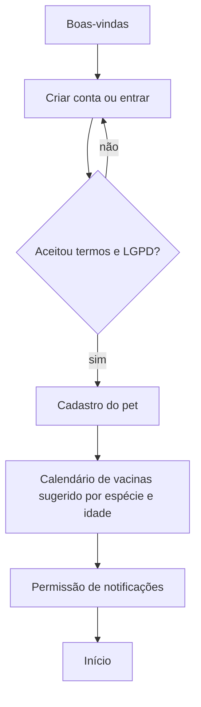

### 19.2 Saúde, lembrete e clínica

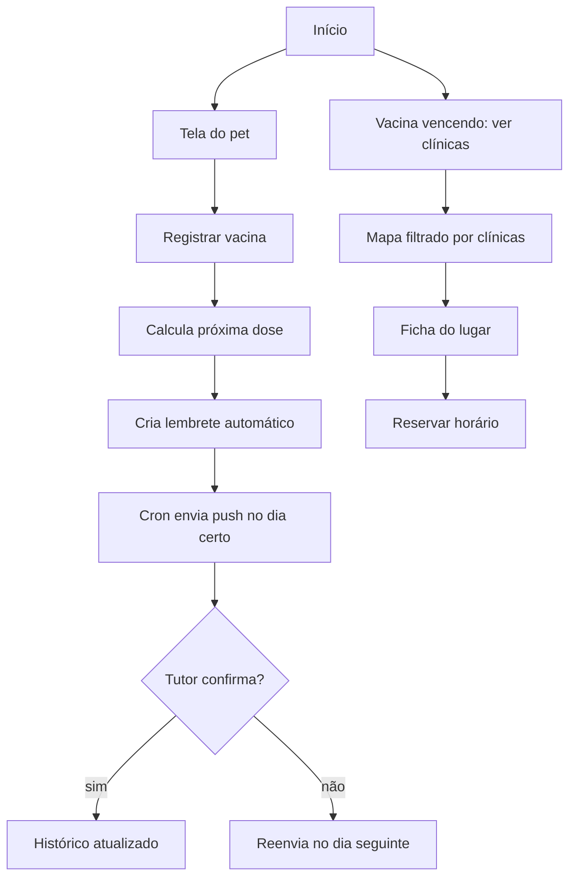

### 19.3 Remédio com doses

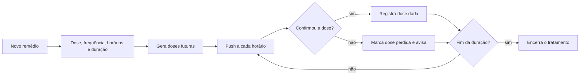

### 19.4 Compra de produto (retirada ou entrega)

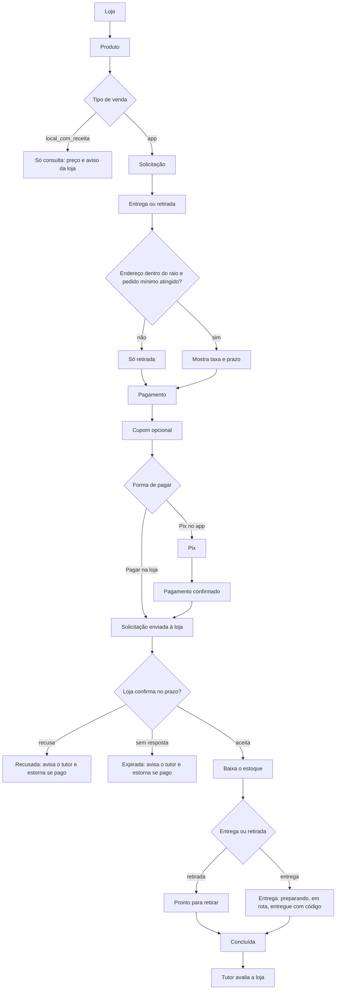

### 19.5 Reserva de serviço (banho e tosa, consulta, vacinação)

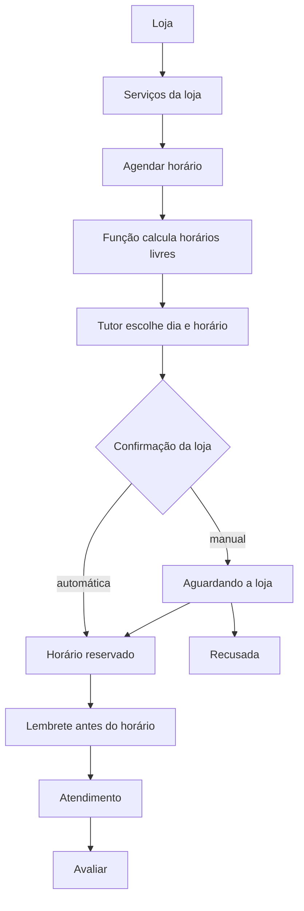

### 19.6 Passeio, creche e hotelzinho

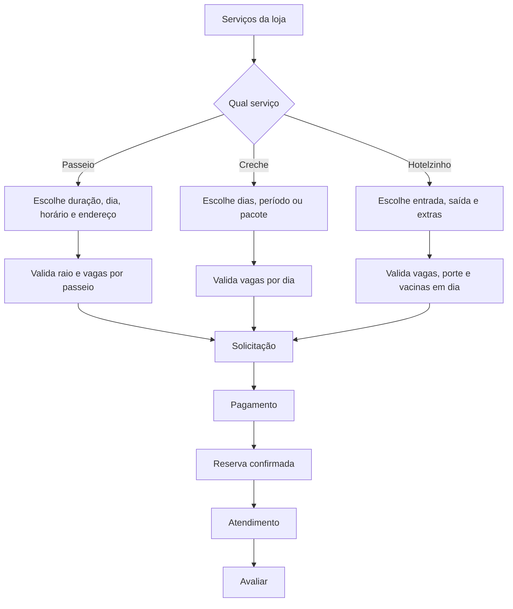

### 19.7 Passeio ao vivo

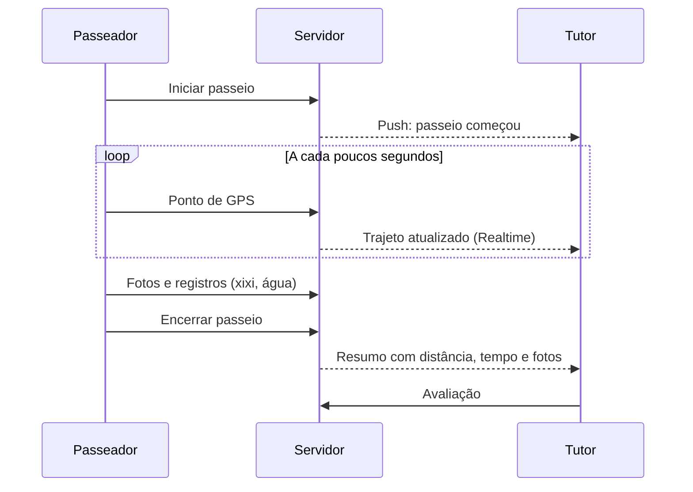

### 19.8 Entrega

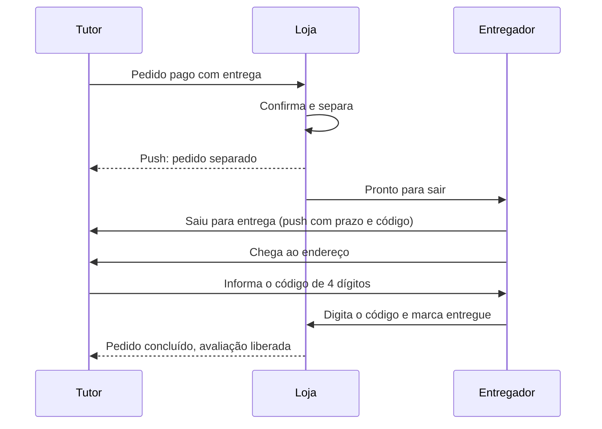

### 19.9 Cadastro e publicação da loja

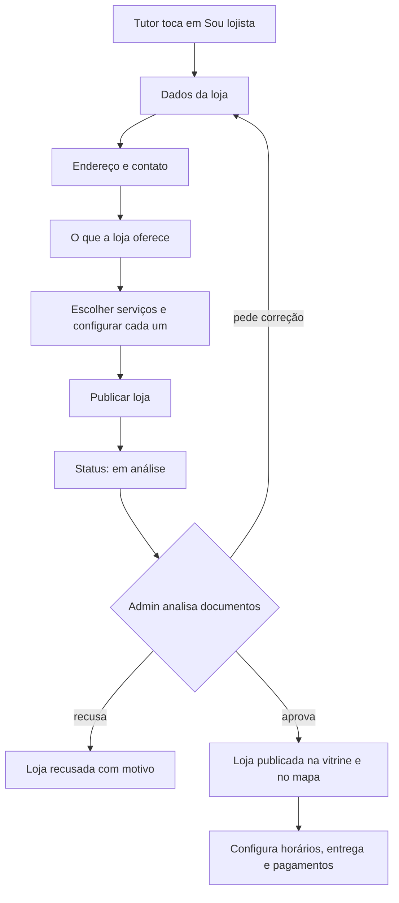

### 19.10 Dia a dia do lojista

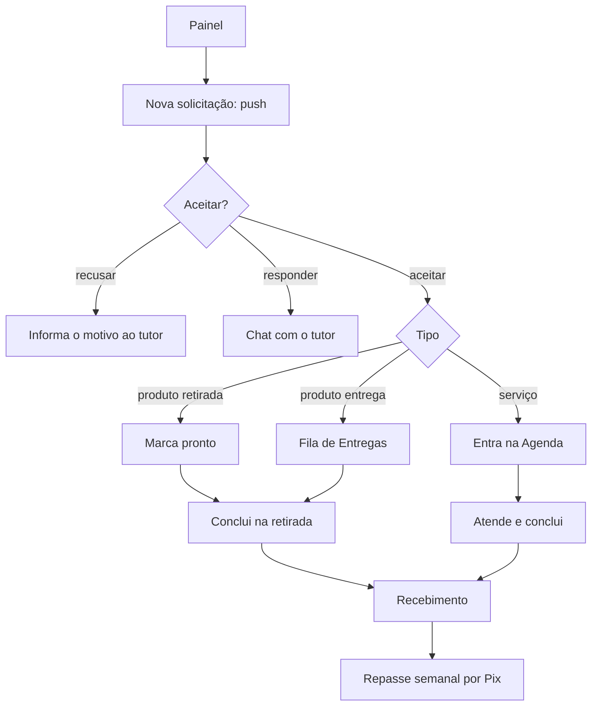

### 19.11 Premium

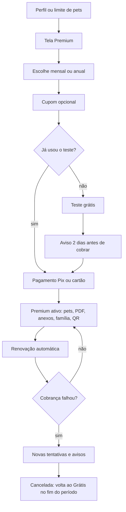

### 19.12 QR da coleira: pet encontrado

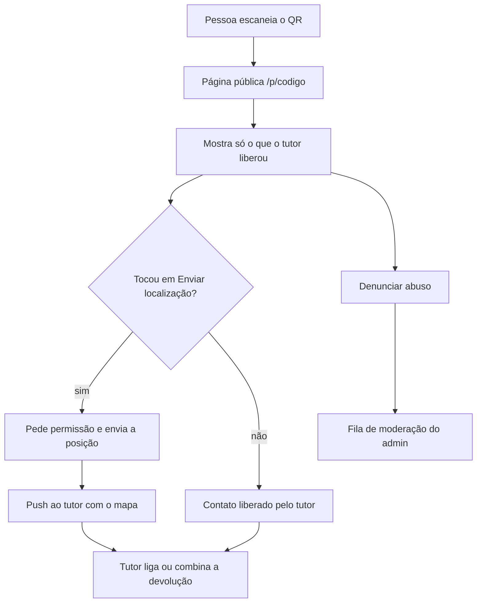

### 19.13 Avaliação

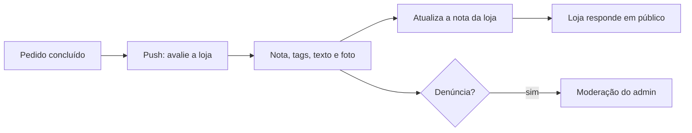

### 19.14 Admin: aprovação de loja, disputa e avaliações dos apps

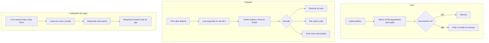

### 19.15 Admin: suporte e privacidade

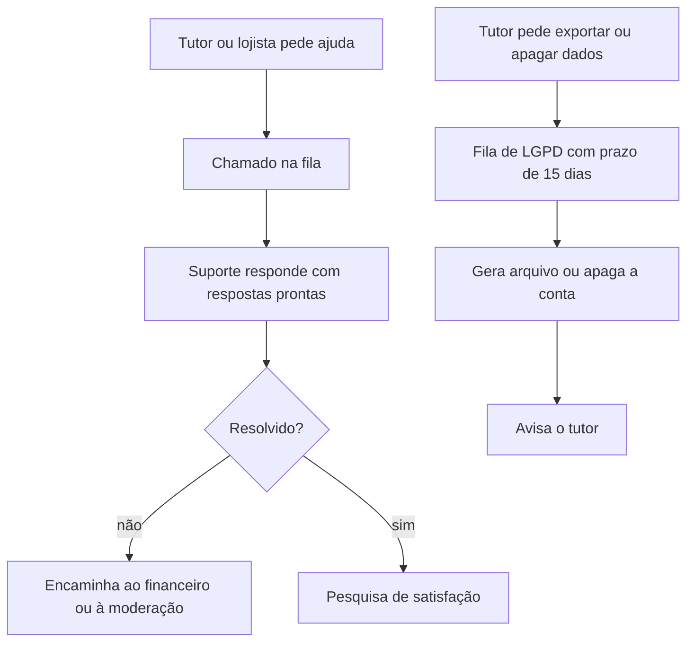

---

## 20. Máquinas de estado

Cada mudança de estado grava uma linha em `request_events` (ou na tabela de eventos equivalente), com quem mudou, quando e o motivo. Estados em `snake_case` no banco, com texto em português na tela.

### 20.1 Solicitação (`requests`)

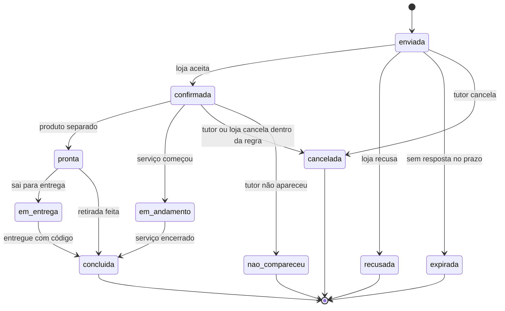

### 20.2 Pagamento (`payments`)

`pendente` → `pago` → (`estornado` | `repassado`). Se o Pix passar da validade, `pendente` vira `expirado`. Pagar na loja não cria `payments` no app. Pedido recusado, expirado ou cancelado com pagamento `pago` gera estorno automático.

### 20.3 Entrega (`deliveries`)

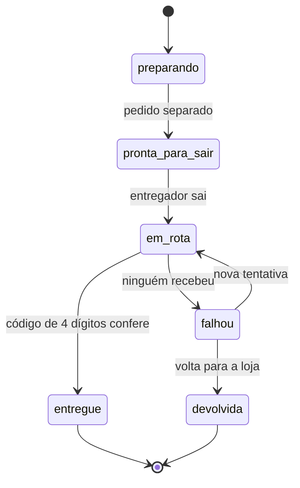

### 20.4 Assinatura Premium (`subscriptions`)

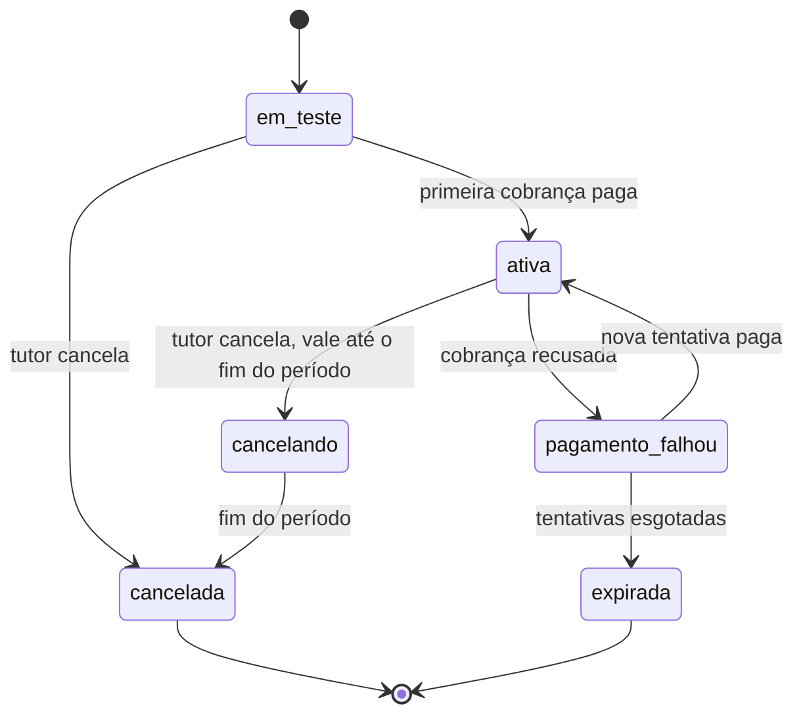

### 20.5 Loja (`stores.status`)

`rascunho` → `em_analise` → (`aprovada` | `correcao_pedida` | `recusada`). `correcao_pedida` volta para `em_analise` quando o lojista reenvia. `aprovada` pode ficar `suspensa` por ação do admin e voltar. Além do status, a loja tem o interruptor **aberta ou fechada**, que o próprio lojista liga e desliga e só afeta pedidos novos.

### 20.6 Disputa (`disputes`)

`aberta` → `resposta_da_loja` → `em_analise` → `resolvida`, com o resultado `estorno`, `a_favor_da_loja` ou `acordo`. Se a loja não responde no prazo, vai direto para `em_analise`.

### 20.7 Passeio (`walks`)

`agendado` → `iniciado` → `em_andamento` (recebe pontos de GPS) → `encerrado` → `avaliado`. Um passeio `agendado` que ninguém inicia até `[30]` minutos depois do horário vira `perdido` e avisa a loja e o tutor.

### 20.8 Cupom (`coupons`)

`agendado` → `ativo` → (`esgotado` | `encerrado`). O banco confere limite de usos e validade na hora de aplicar, nunca só o app.

### 20.9 Chamado de suporte (`support_tickets`)

`aberto` → `em_atendimento` → `aguardando_usuario` → `resolvido`. O tutor responder reabre o chamado.

### 20.10 Pedido de privacidade (`lgpd_requests`)

`novo` → `aguardando_confirmacao` (apagar conta exige confirmar por e-mail) → `em_andamento` → `concluido`. O campo `due_at` guarda o prazo de 15 dias.

---

## 21. Modelo de dados completo

Convenções: `id uuid` em todas as tabelas, `created_at` e `updated_at`, soft delete (`deleted_at`) onde houver histórico. Valores em reais ficam em centavos (`*_cents integer`). Datas em UTC, exibidas no fuso de São Paulo.

### 21.1 Tutor, pets e saúde

| Tabela | Campos principais |
| --- | --- |
| `profiles` | `user_id`, `name`, `phone`, `city`, `plan` (`free`/`premium`), `onboarded_at`, `terms_version`, `terms_accepted_at` |
| `pets` | `owner_id`, `name`, `species` (`dog`/`cat`), `breed_id`, `birth_date`, `sex`, `weight_kg`, `photo_url`, `allergies` |
| `pet_members` | `pet_id`, `user_id`, `role` (`owner`/`family`), usado pelo acesso da família |
| `vaccinations` | `pet_id`, `vaccine_id`, `applied_at`, `next_due_at`, `vet_name`, `batch`, `attachment_url` |
| `dewormings` | `pet_id`, `product`, `applied_at`, `next_due_at` |
| `weights` | `pet_id`, `kg`, `measured_at` |
| `visits` | `pet_id`, `date`, `reason`, `vet_name`, `notes`, `attachments` |
| `medications` | `pet_id`, `name`, `dose`, `every_hours`, `times[]`, `starts_at`, `ends_at`, `active` |
| `medication_doses` | `medication_id`, `scheduled_at`, `status` (`pendente`/`dada`/`perdida`), `confirmed_at` |
| `reminders` | `pet_id`, `type`, `title`, `due_at`, `repeat_rule`, `status`, `source` (`manual`/`vacina`/`remedio`/`reserva`) |
| `push_tokens` | `user_id`, `token`, `platform`, `last_seen_at` |
| `notification_prefs` | `user_id`, `type`, `enabled`, `quiet_from`, `quiet_to` |
| `pet_qr_settings` | `pet_id`, `code` (único, curto), `show_photo`, `show_phone`, `show_allergies`, `active` |
| `qr_scans` | `pet_id`, `scanned_at`, `lat`, `lng` (só se a pessoa enviou), `ip_hash` |

### 21.2 Mapa e conteúdo mestre

| Tabela | Campos principais |
| --- | --- |
| `places` | `osm_id`, `name`, `kind` (`clinica`/`petshop`/`banho_tosa`/`24h`), `geom`, `address`, `phone`, `claimed_store_id` |
| `content_vaccines` | `name`, `species`, `first_dose_days`, `booster_rule`, `mandatory`, `text`, `version` |
| `content_breeds` | `species`, `name` |
| `content_categories` | `name`, `parent_id`, `sort` |
| `content_versions` | `version`, `published_at`, `published_by` |

### 21.3 Lojas e catálogo

| Tabela | Campos principais |
| --- | --- |
| `stores` | `name`, `kind`, `oferece` (`produtos`/`servicos`/`ambos`), `status`, `is_open`, `address`, `geom`, `phone`, `cnpj`, `pix_key`, `response_deadline_min`, `auto_confirm`, `cancel_until_min`, `rating_avg`, `rating_count`, `pickup_enabled`, `pickup_prepare_min`, `pickup_hours`, `delivery_enabled`, `delivery_mode` (`fixa`/`bairro`/`distancia`), `delivery_fee_cents`, `delivery_radius_km`, `delivery_min_order_cents`, `delivery_free_over_cents`, `delivery_eta_min`, `delivery_eta_max`, `delivery_hours` |
| `store_members` | `store_id`, `user_id`, `role` (`owner`/`manager`/`staff`), `function` (`atendente`/`tosador`/`passeador`), `active` |
| `store_documents` | `store_id`, `type`, `file_url`, `status` |
| `store_hours` | `store_id`, `weekday`, `opens`, `closes` |
| `time_off` | `store_id`, `starts_at`, `ends_at`, `reason` |
| `delivery_zones` | `store_id`, `neighborhood`, `fee_cents`, `eta_min`, `eta_max`, `active` |
| `delivery_bands` | `store_id`, `from_km`, `to_km`, `fee_cents` (modo por distância) |
| `products` | `store_id`, `name`, `category_id`, `price_cents`, `photo_url`, `barcode`, `venda` (`app`/`local_com_receita`/`oculto`), `receita_msg`, `stock`, `stock_min`, `hide_when_zero`, `active` |
| `services` | `store_id`, `name`, `modelo` (`horario`/`passeio`/`dia`/`diarias`), `duration_min`, `capacity`, `buffer_min`, `price_cents`, `active` |
| `lodging_rates` | `service_id`, `size` (`pequeno`/`medio`/`grande`), `night_cents`, `extras` (jsonb), `requires_vaccines` |
| `daycare_plans` | `service_id`, `period` (`dia`/`meio`), `price_cents`, `package_days`, `package_cents` |
| `walk_rules` | `service_id`, `price_30_cents`, `price_60_cents`, `radius_km`, `max_pets`, `weekdays`, `window` |

### 21.4 Pedidos, entrega, pagamento e relacionamento

| Tabela | Campos principais |
| --- | --- |
| `requests` | `user_id`, `store_id`, `kind` (`produto`/`servico`), `status`, `fulfillment` (`retirada`/`entrega`), `starts_at`, `ends_at`, `checkin`, `checkout`, `pet_id`, `subtotal_cents`, `delivery_fee_cents`, `discount_cents`, `total_cents`, `coupon_id`, `pay_method` (`pix_app`/`na_loja`), `message`, `responded_at`, `address_id` |
| `request_items` | `request_id`, `product_id` ou `service_id`, `qty`, `unit_cents` |
| `request_events` | `request_id`, `from_status`, `to_status`, `actor_id`, `reason`, `at` |
| `addresses` | `user_id`, `label`, `street`, `number`, `complement`, `neighborhood`, `city`, `geom`, `note` |
| `deliveries` | `request_id`, `status`, `courier_id`, `code`, `eta_at`, `left_at`, `delivered_at`, `fail_reason` |
| `payments` | `request_id` ou `subscription_id`, `provider_id`, `method`, `amount_cents`, `status`, `paid_at`, `expires_at`, `pix_payload`, `commission_cents` |
| `payouts` | `store_id`, `period_from`, `period_to`, `amount_cents`, `status` (`agendado`/`pago`/`falhou`), `paid_at` |
| `coupons` | `scope` (`loja`/`plataforma`), `store_id`, `code`, `type` (`percentual`/`valor`/`dias_premium`), `value`, `applies_to`, `min_cents`, `max_uses`, `used`, `starts_at`, `ends_at`, `status` |
| `coupon_uses` | `coupon_id`, `user_id`, `request_id` ou `subscription_id`, `at` |
| `reviews` | `request_id` (único), `store_id`, `user_id`, `rating`, `tags[]`, `text`, `photo_url`, `reply_text`, `replied_at`, `hidden` |
| `conversations` | `request_id` (único), `store_id`, `user_id`, `closed_at` |
| `messages` | `conversation_id`, `sender_id`, `body`, `read_at`, `at` |
| `walks` | `request_id`, `walker_id`, `status`, `started_at`, `ended_at`, `distance_m`, `summary` |
| `walk_points` | `walk_id`, `geom`, `at` |
| `walk_events` | `walk_id`, `type` (`foto`/`xixi`/`coco`/`agua`), `media_url`, `at` |

### 21.5 Plataforma e admin

| Tabela | Campos principais |
| --- | --- |
| `plans` | `code`, `name`, `price_cents`, `period` (`mensal`/`anual`), `trial_days`, `active` |
| `subscriptions` | `user_id`, `plan_id`, `status`, `started_at`, `renews_at`, `cancel_at`, `cancel_reason`, `trial_ends_at`, `retry_count` |
| `disputes` | `request_id`, `opened_by`, `reason`, `status`, `store_reply`, `decision`, `decided_by`, `decided_at` |
| `reports` | `kind` (`avaliacao`/`anuncio`/`pet_encontrado`), `target_id`, `reporter_id`, `reason`, `priority`, `status`, `handled_by` |
| `support_tickets` | `requester_id`, `requester_type`, `subject`, `priority`, `status`, `assignee_id`, `app_version`, `platform` |
| `support_messages` | `ticket_id`, `sender_id`, `body`, `at` |
| `canned_replies` | `title`, `body` |
| `campaigns` | `title`, `body`, `audience` (jsonb), `channel`, `send_at`, `status`, `sent`, `opened`, `clicked` |
| `lgpd_requests` | `user_id`, `type` (`exportar`/`apagar`/`corrigir`), `status`, `due_at`, `done_at` |
| `admin_members` | `user_id`, `role`, `active`, `last_seen_at` |
| `audit_log` | `actor_id`, `action`, `target_type`, `target_id`, `meta`, `at` |
| `app_reviews` | `platform` (`play`/`app_store`), `external_id`, `rating`, `author`, `text`, `app_version`, `at`, `reply_text`, `replied_at` |
| `integrations` | `provider`, `status`, `last_sync_at`, `expires_at`, `config` (criptografado) |
| `app_versions` | `platform`, `version`, `min_supported`, `released_at` |
| `feature_flags` | `key`, `enabled`, `rollout_pct` |

### 21.6 Regras de acesso (RLS) por tabela

| Quem | Pode |
| --- | --- |
| Tutor | Ler e escrever os próprios `pets`, saúde, lembretes, `addresses`, `requests`, `reviews`, `messages` e `subscriptions`. Ler `stores` e `products` publicados |
| Família | Ler e escrever nos pets em que consta em `pet_members`, sem acesso a pagamentos |
| Lojista | Ler e escrever dados da própria loja e `requests`, `deliveries`, `conversations` e `reviews` dela, conforme a função em `store_members` |
| Anônimo | Nada direto. A página `/p/[codigo]` chama uma função pública que devolve só os campos liberados |
| Admin | Acesso por função em `admin_members`, via funções seguras. Toda leitura de dado de saúde exige autorização do tutor e grava `audit_log` |

Regras que o banco precisa garantir, não só o app:
- `requests` de produto `local_com_receita` são rejeitadas.
- `reviews` só para `requests` com status `concluida` do próprio usuário, uma por pedido.
- `coupon_uses` respeita limite de usos e validade em uma única transação.
- Estoque nunca fica negativo.
- Um horário nunca passa do limite de vagas do serviço.

---

## 22. Notificações

Canal: **push** (P), **e-mail** (E) ou **na tela de Avisos** (A). O tutor controla tipo e horário em Avisos. Mensagens de segurança e de pagamento ignoram o Não perturbe.

| Evento | Quem recebe | Canal |
| --- | --- | --- |
| Vacina ou vermífugo vencendo (7 e 1 dia) | Tutor | P, A |
| Hora do remédio | Tutor | P |
| Dose perdida | Tutor | P, A |
| Nova solicitação | Lojista e equipe com permissão | P |
| Solicitação confirmada, recusada ou expirada | Tutor | P, A |
| Pedido pronto para retirar | Tutor | P |
| Saiu para entrega, com prazo e código | Tutor | P |
| Entrega concluída e pedido de avaliação | Tutor | P |
| Mensagem nova no chat | Tutor ou loja | P |
| Lembrete de reserva (24 h e 2 h antes) | Tutor e loja | P |
| Passeio iniciado e encerrado | Tutor | P |
| Pagamento confirmado, falhou ou expirou | Tutor e loja | P, E |
| Estorno feito | Tutor e loja | P, E |
| Repasse enviado ou com falha | Loja | E |
| Premium: teste acabando, renovação, falha | Tutor | P, E |
| Pet encontrado: localização enviada | Tutor | P |
| Loja aprovada, correção pedida ou recusada | Lojista | P, E |
| Disputa aberta e decisão | Tutor e loja | P, E |
| Avaliação nova | Loja | P |
| Nota baixa de app sem resposta | Equipe admin | A no painel |
| Pedido de exportar ou apagar dados | Equipe admin | A no painel |
| Campanha | Público escolhido | P, E |

---

## 23. Backend: funções, jobs e integrações

### 23.1 Edge Functions

| Função | O que faz |
| --- | --- |
| `free-slots` | Calcula horários livres de um serviço em um dia |
| `quote-delivery` | Valida endereço no raio e devolve taxa, prazo e motivo de bloqueio |
| `create-request` | Cria a solicitação checando estoque, mínimo, horário e cupom em uma transação |
| `apply-coupon` | Valida e reserva o uso do cupom |
| `create-pix-charge` | Gera a cobrança Pix de pedido ou assinatura |
| `pix-webhook` | Recebe a confirmação, marca `pago` e avisa as partes |
| `refund` | Estorna um pagamento e ajusta o repasse |
| `public-qr` | Devolve os campos liberados do pet, com limite de acessos por IP |
| `qr-location` | Recebe a localização e avisa o tutor |
| `export-pet-card` | Gera o PDF da carteira de saúde |
| `lgpd-export` e `lgpd-delete` | Geram o arquivo do tutor e apagam a conta |
| `send-campaign` | Dispara a campanha por push e e-mail |
| `reply-app-review` | Responde avaliação nas lojas de apps |

### 23.2 Cron e jobs

| Job | Frequência | O que faz |
| --- | --- | --- |
| `send-reminders` | A cada minuto | Envia push de lembretes e doses vencendo |
| `mark-missed-doses` | Hora em hora | Marca doses perdidas |
| `expire-requests` | A cada 5 min | Expira solicitações sem resposta e estorna se pago |
| `expire-pix` | A cada 5 min | Expira Pix vencido |
| `close-chats` | Diário | Fecha conversas 7 dias após a conclusão |
| `subscription-billing` | Diário | Avisa renovação, cobra e faz novas tentativas |
| `weekly-payout` | Semanal | Calcula e envia o repasse por Pix |
| `sync-app-reviews` | A cada hora | Importa avaliações do Play e da App Store |
| `import-osm-places` | Semanal | Atualiza `places` pelo OpenStreetMap |
| `cleanup` | Diário | Remove tokens inválidos e arquivos soltos |

### 23.3 Tempo real (Supabase Realtime)

Chat (`messages`), status da entrega (`deliveries`), trajeto do passeio (`walk_points`) e status da solicitação (`requests`). Cada canal respeita a mesma RLS das tabelas.

### 23.4 Integrações externas

| Integração | Uso | Observação |
| --- | --- | --- |
| Provedor de Pix `[a definir]` | Cobrança, webhook, repasse e estorno | Obrigatório antes da etapa 2 |
| Google Play Developer API | Importar e responder avaliações | Credencial guardada em `integrations` |
| App Store Connect API | Importar e responder avaliações | Chave tem validade: o admin avisa antes de expirar |
| FCM e APNs | Push | Via expo-notifications |
| OpenStreetMap | Tiles, lugares e geocodificação | Respeitar limites de uso e cache |
| Sentry | Erros dos apps e painéis | |
| Provedor de e-mail `[a definir]` | Recibos, recuperação de senha, campanhas | |

---

## 24. Critérios de pronto por módulo

Um módulo só é considerado pronto quando cumpre todos os itens abaixo.

- Telas iguais ao protótipo em textos, estados vazios e de erro.
- Regras da seção 5 aplicadas **no banco ou na função**, não só na tela.
- RLS testada com ao menos um usuário de cada papel e um usuário sem permissão.
- Notificações do módulo enviadas conforme a seção 22.
- Estados da seção 20 respeitados e registrados em eventos.
- Funciona sem rede quando for leitura de saúde do pet (cache local) e mostra erro claro quando for escrita.
- Acessível: texto com contraste, alvos de toque de 44 px e rótulos em ícones.
- Sentry ligado e eventos de uso medindo as métricas da seção 14.
- Teste automatizado do fluxo principal (E2E) e dos cálculos (horários livres, taxa de entrega, cupom, comissão).

---

## 25. Ordem de construção

Cada bloco depende dos anteriores. Os números P0 a P3 são os do board.

| Bloco | O que entrega | Depende de | Prioridade |
| --- | --- | --- | --- |
| 0. Base | Repositório, Expo, Supabase, tema, autenticação, RLS base, Sentry, EAS | Nada | P0 |
| 1. Pets e saúde | Cadastro do pet, vacinas, peso, consultas, calendário sugerido | 0 | P0 e P1 |
| 2. Lembretes e remédios | Lembretes, doses, push, tela de Avisos | 1 | P0 e P1 |
| 3. Mapa | `places`, mapa, ficha do lugar, ligar e rota | 0 | P1 |
| 4. Início e perfil | Início com próximas vacinas e lugares, perfil, termos, excluir conta | 1, 2, 3 | P0 e P1 |
| 5. Premium | Assinatura, PDF, anexos, família, QR da coleira e página pública | 1, Pix | P2 |
| 6. Admin mínimo | Login com 2FA, visão geral, usuários, assinaturas, planos, conteúdo mestre, avaliações dos apps, suporte, equipe | 0, 5 | P2 |
| 7. Loja, etapa 1 | Cadastro da loja, aprovação pelo admin, catálogo, vitrine, solicitação, aceite, agenda por horário, retirada | 0, 6 | P2 |
| 8. Entrega, chat, estoque, cupons, avaliações | Entrega com taxa e código, chat, estoque, cupons, avaliações | 7 | P2 |
| 9. Pagamentos, etapa 2 | Pix no app, repasse, estorno, disputas, financeiro e pedidos no admin | 7, 8 | P2 e P3 |
| 10. Serviços avançados | Passeio ao vivo, creche, hotelzinho | 7, 9 | P3 |
| 11. Painel do lojista | Todas as telas do computador (relatórios, equipe, promoções) | 7, 8 | P2 e P3 |
| 12. Operação do admin | Lojistas, moderação, campanhas, integrações, sistema, LGPD | 6, 7 | P2 e P3 |
| 13. Site | Página inicial, página para lojistas e página pública do QR | 5 | P2 |
| 14. Rede social | Perfil público, posts, feed | Retenção provada no beta | Fora do board |

Regra prática: **nenhum bloco de marketplace (7 em diante) começa antes de o bloco 4 estar no ar para teste com tutores reais**, para validar retenção antes de investir em lojas.

---

## 26. Contas de teste e dados de exemplo

Para desenvolver e testar sem dados reais:
- Seed com 1 tutor grátis, 1 tutor Premium, 1 loja de produtos, 1 loja de serviços, 1 loja com os dois, 1 passeador e 1 usuário de cada função do admin.
- Conteúdo mestre com o calendário de vacinas de cães e gatos e 20 raças.
- Cupons de exemplo (percentual, valor fixo e Premium grátis).
- Lojas de teste com entrega por bairro, por distância e só retirada.
- Pix em modo de teste do provedor. Nenhuma cobrança real em desenvolvimento.

---

## 27. Perguntas que a equipe de desenvolvimento deve resolver cedo

1. Provedor de Pix e de e-mail (afeta os blocos 5 e 9).
2. App do lojista como PWA ou nativo (afeta os blocos 7 e 11 e o passeio ao vivo, que precisa de GPS em segundo plano).
3. Framework web dos painéis e do site (um só projeto web com áreas separadas ou projetos distintos).
4. Como o entregador usa o sistema: acesso próprio com função `staff` ou só a equipe da loja digitando o código.
5. Premium por cartão: o provedor precisa oferecer Pix e cartão com cobrança recorrente.
6. Onde ficam os arquivos de saúde e como serão criptografados.
